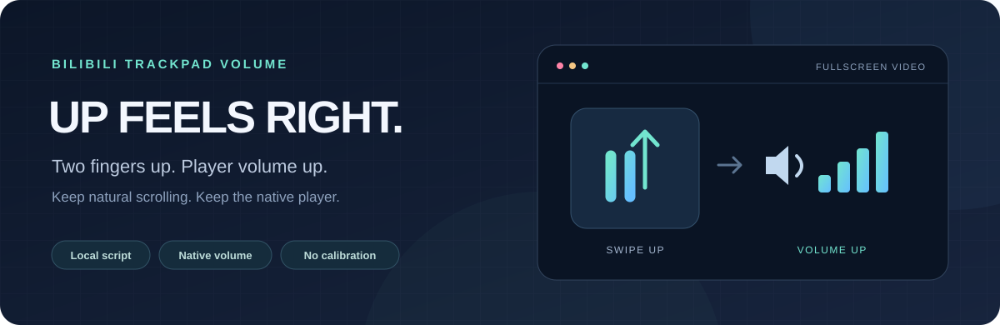

<p align="center"></p>

# Bilibili Trackpad Volume

**Keep macOS natural scrolling. Swipe up to raise volume in Bilibili fullscreen video.**

[Install the userscript](https://raw.githubusercontent.com/haoxy12138/bilibili-trackpad-volume/main/bilibili-trackpad-volume.user.js) · [Releases](https://github.com/haoxy12138/bilibili-trackpad-volume/releases) · [中文说明](README.md)

## Install

1. Enable [Tampermonkey](https://www.tampermonkey.net/) in Chrome.
2. In Chrome's extension details for Tampermonkey, enable **Allow User Scripts**.
3. Open the installation link above and confirm **Bilibili 网页全屏音量方向**.
4. Reload any open Bilibili video tab. Enter web fullscreen or fullscreen, place the pointer over the picture, and swipe vertically.

Keep the extension, the userscript and its execution permission enabled. The dashboard does not need to stay open.

Existing local v1.0.2 installations can update through the same link: the userscript name and namespace remain unchanged. Reload the video after updating. Releases also include a ZIP for Tampermonkey's Utilities → Import and SHA-256 checksums.

## Behavior

| Area / gesture | Result |
| --- | --- |
| Fullscreen video picture | Swipe up raises volume; swipe down lowers it |
| Normal player mode / other page areas | Original behavior |
| Player control bar / text inputs | Original behavior |
| Predominantly horizontal gestures or Ctrl / ⌘ scrolling | Original behavior |

**This script does not detect the input device.** Mouse-wheel volume direction is also reversed inside the target area. It is intended for users who primarily watch with a natural-scrolling trackpad.

Volume steps, mute behavior and indicators remain the native player's responsibility. System volume and macOS scroll settings are not modified.

## Implementation and privacy

The script matches only `https://www.bilibili.com/video/*` and runs at `document-start` in the page's main world. It wraps `wheel` / `mousewheel` listeners and reverses their view of `deltaY`, `wheelDelta` and `wheelDeltaY` only for events over the fullscreen picture. Other event properties and native methods retain their original receiver; the original event object is not rewritten.

Listener removal preserves target, type and capture identity. The script does not dispatch synthetic events or implement a separate volume controller.

`@grant none`, no dependencies, no runtime network requests, no cookies, account data, persistent storage or telemetry. The userscript manager may contact this repository to check for updates according to its own settings.

## Verification and limits

- The v1.0.2 core behavior was confirmed with real trackpad gestures on macOS 27.0.1, Chrome 155 and Tampermonkey 5.5.1.
- v1.0.3 preserves that event-handling logic and removes diagnostics for public distribution.
- Automated tests cover direction, scope, native event methods and listener lifecycle. They do not replace physical trackpad testing.
- Other browsers, bangumi, live streams and embedded players have not been verified. Bilibili player updates may require adaptation.

Disable other volume-reversal scripts/components before use. To undo, disable or remove this userscript in Tampermonkey and reload the video tab.

## Development

Node.js 22+ and Python 3. No npm dependencies.

```sh
npm run check
npm test
npm run check:release
npm run build
```

See [CONTRIBUTING.md](CONTRIBUTING.md). Build artifacts are written to `dist/`.

An optional [GitHub Actions workflow template](docs/ci.yml) is included. Save it as `.github/workflows/ci.yml` to enable remote CI; remote CI is not enabled in this release.

## Credits

Inspired by Max Chang's [Bilibili-Trackpad-Scroll-Reverser](https://github.com/maxchang3/Bilibili-Trackpad-Scroll-Reverser) and [article](https://maxchang.me/posts/natural-scroll-in-web-video-volume-contorl/). This is an independent implementation, not an official release of that project.

[MIT License](LICENSE). Not affiliated with Bilibili or Tampermonkey.
